<p align="center">
  
</p>

<p align="center">
  <a href="https://github.com/ultiomusic/gamedev-skill/actions/workflows/validate.yml"></a>
</p>

For game developers using Claude Code or Codex: describe what feels wrong in your game, like a floaty jump or a stutter, and it finds the cause and fixes it in your own code.

<!-- DEMO GIF (5-10 s): record `/gamedev the jump feels floaty` from the request to the fixed jump, save it as images/demo.gif, and swap this comment for that image. -->

```bash
git clone https://github.com/ultiomusic/gamedev-skill.git ~/.claude/skills/gamedev
```

For Codex, clone into `~/.agents/skills/gamedev` instead. To install for one project only, clone into `.claude/skills/gamedev` or `.agents/skills/gamedev` inside it. Restart the session afterwards.

## Use

<p align="center">
  
</p>

Ask in plain words, or call it directly (`$gamedev` in Codex):

```text
/gamedev add coyote time and a jump buffer, keep the jump height
/gamedev the decal on the floor flickers
/gamedev shooting stutters every few seconds
/gamedev audit this game without editing files
```

## What it knows

<p align="center">
  
  
  
  
</p>

Engine notes for Unity, Godot, Unreal, Bevy and the web load only when your project uses that engine.

## Contributing

New concepts, engine notes and bug reports are welcome. See [CONTRIBUTING.md](CONTRIBUTING.md). Released under the [MIT License](LICENSE).
