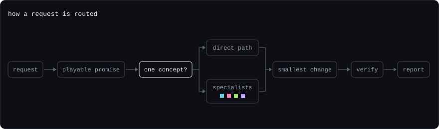
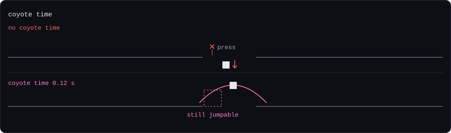
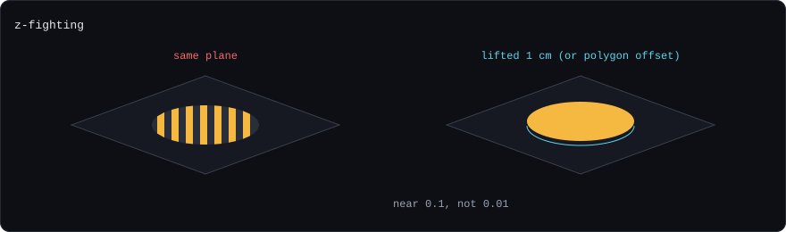
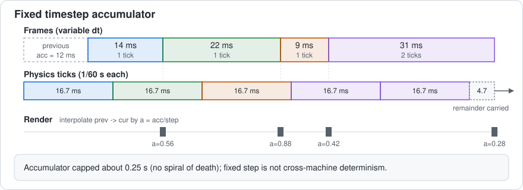
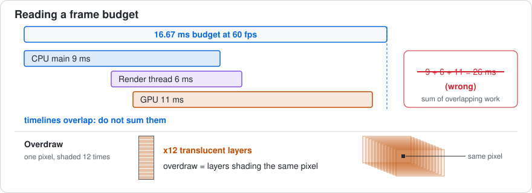

# gamedev

A shared skill for Claude Code and Codex that builds, tunes, and repairs games through four
specialist roles: 3D & Rendering, Game Feel, Systems, and Performance. It starts from what the
player can perceive, decide, and do, finds the earliest mismatch between intent and outcome,
and lands the smallest change that fixes it, with proof.
Entry point: [`skills/gamedev/SKILL.md`](skills/gamedev/SKILL.md).



## What happens on a request

1. **Playable promise.** The request becomes one sentence with four parts: the action and
   device, the intended quality, the rule and consequence to preserve, and the repeatable
   proof. "Heavier movement" becomes "WASD on keyboard; weighty but controllable; same top
   speed and collision; equal distance at 40 and 144 fps, stopping within the agreed distance."
2. **Discovery once.** The coordinator inspects the real engine and version, the entry scene,
   the input path, and serialized configuration, and traces the normal player path. An unused
   script, a debug shortcut, or a stale build is not the running game. This discovery is shared
   so no specialist repeats it.
3. **Route.** A request that names one concept or a small tuning fix inside one domain takes
   the **direct path**: the coordinator reads the owning brief, starts from its
   `Starting values and traps` row, applies it in the project's existing owner, runs the row's
   check, and reports. Mixed or audit work goes to **specialists**: a lead plus supporting roles,
   or all four for a requested full audit.
4. **Delegate with a bounded assignment.** Each specialist receives the shared constraints, its
   own brief, the playable promise, project facts, an explicit read-only or write scope, and the
   owner of shared resources (controller, scene, Editor, tests). Independent investigations run
   in parallel; a shared file has one writer. Specialists return evidence, the smallest change,
   actual checks, and cross-domain dependencies. They never spawn the same team again.
5. **Integrate the smallest change.** Findings are merged by cause and conflicts are settled
   against the promise: Systems decides rules and commit points, Game Feel aligns response,
   3D & Rendering checks the image, Performance measures cost. One coherent change, in the
   project's existing owners, with failed experiments removed rather than hidden.
6. **Verify and report.** The smallest relevant existing checks run; the normal interaction,
   repetition, boundary, interruption, and recovery are exercised; timing is compared at several
   render and physics rates; visuals are inspected in rendered output; performance is measured on
   a representative build. The report states what was checked, what was not, and the tradeoffs.
   Static reasoning is never reported as a playtest.

## Direct path or specialists?

| Request | Route | Why |
| --- | --- | --- |
| "Add coyote time to the jump." | Direct, Game Feel brief | One concept, one owner, one check (presses at several frame rates). |
| "The selection ring flickers on the floor." | Direct, 3D & Rendering brief | Single visual defect with a known trap (coplanar surfaces). |
| "Shooting stutters even though I added a pool." | Systems lead, Performance support | Pool reset is a rules question; the stutter needs a capture. |
| "Movement is slower at 40 fps than at 144 fps." | Game Feel lead, Systems support | Units and clock ownership cross two domains. |
| "Audit this game without editing files." | All four, read-only | Requested full audit; findings merged by player impact. |

Taking the direct path on a narrow task is the intended behavior, not a limitation. If the
host offers no delegation at all, the same briefs run sequentially in the main agent, which
says so.

## The four specialists

Each brief is a working role: what it owns, how it locates a failure, a concrete exercise, a
`Starting values and traps` table for its concepts, and a return contract to the coordinator.
Starting values are hypotheses to test in the project at hand, at its frame rates and on its
devices, never settings to copy.

### Game Feel (`gamedev-game-feel`)



Owns perceived response and event timing: input acknowledgment versus acceptance, movement
tuning, action rhythm, camera motion, and audiovisual feedback. It chooses the earliest mismatch
in intent, acknowledgment, acceptance, commit, feedback, and readiness, and preserves the
intended tension (heavy yet controllable, relaxed yet consequential).

Concepts: delta time, fixed timestep bridge, acceleration and friction, coyote time, input
buffering, easing, camera deadzone, screen shake, squash and stretch, hit stop, invincibility
frames. Typical traps it rules out first: dt applied twice, a fixed lerp factor, grace refilled
from stale grounded state on the takeoff frame, a buffer that never expires, hit stop timed on
the clock it freezes, shake accumulated into the base camera pose.

Example: "Players miss ledge jumps and sometimes double jump." The brief leads to consuming the
grace window on jump, bounding the buffer to about 0.1 s with one consumption, never queueing a
rejected press, and proving it with early, late, and rapid presses at low, target, and high
frame rates while jump height and gravity stay untouched.

### 3D & Rendering (`gamedev-3d-rendering`)



Owns the image and its relationship to the world: geometry and spaces, normals, materials and
pipeline, light and shadow, camera projection, and visual hierarchy. It traces source asset,
local pose, world pose, projection, material, and final image to the earliest mismatch, and
checks the active scene, pipeline, and viewport before editing anything.

Concepts: raycasting, normals, quaternions, billboarding, z-fighting, level of detail, frustum
culling, fragment shader. Typical traps: a position used as a normal, the model matrix applied
to normals under nonuniform scale, a label projected from a stationary root instead of the
visible child, a label drawn when the target is behind the camera, coplanar decals, culling by
origin point only.

Example: "The ring flickers, the label floats beside the character, and health bars tilt." The
brief separates four causes, fixes each with the smallest correction (offset along the normal
or polygon offset, project the displayed child and skip when z is negative, yaw-only
billboards, inverse-transpose normals), and confirms them by repeating the same camera path in
rendered output, including the smallest supported interaction scale.

### Systems (`gamedev-systems`)



Owns authoritative state and meaningful consequences: eligibility, commitment, settlement,
economy, progression, agent decisions, and persistence. It gives each action one owner and one
commit point, defines what pending work is (queued, replaceable, cancelable, irreversible),
exercises interruption as a state transition, and keeps simulation truth independent of
presentation.

Concepts: fixed timestep, tunneling, state machine, hitbox and hurtbox, object pooling,
particle system, pathfinding, steering behaviors, seeded noise. Typical traps: stepping physics
by raw frame time, a pool that does not reset timers, targets, and listeners, a hit set cleared
every frame, a heuristic that does not match the movement set, a shared random stream shifted
by one extra call.

Example: "Recycled bullets fly toward an old target." The brief points at the incomplete reset
on acquire (velocity, target, lifetime, trail, listeners), a preallocated pool sized to the peak
with an explicit empty-pool policy, and a pool-of-one reuse test that would reject the fix.

### Performance (`gamedev-performance`)



Owns measured cost: frame pacing, CPU and GPU work, allocation, memory residency, and streaming
spikes. It establishes a comparable capture first (same scene, seed, camera, action sequence,
representative build and device), separates main-thread, render submission, GPU, and wait time,
and changes only the cost the evidence identifies. A cheaper frame that drops an action or hides
a threat is not a win.

Concepts: frame budget, draw calls, overdraw, texture atlas, spatial partitioning, time slicing,
chunk streaming. Typical traps: CPU and GPU durations summed into one frame time, fewer draw
calls read as a shorter frame, alpha-zero pixels assumed free, time slicing without a stale
limit or urgent path, a single streaming radius that thrashes on a chunk border.

Example: "The boss arena runs at 40 fps; should we drop shadows and merge every mesh?" The brief
ranks hypotheses (Editor and sync artifacts, overdraw from stacked smoke, per-frame AI and
raycasts), rejects merging everything because it defeats culling, keeps shadows until their cost
is measured, and asks for one player-build capture with percentiles before and after one change.

## Unity

[Unity integration](skills/gamedev/references/unity.md) is read only for Unity projects: where
the truth lives (ProjectVersion, package lock, pipeline and quality settings, serialized
overrides), which movement API owns displacement versus velocity, how to keep scaled and
unscaled time apart, and how to run the Test Framework in batch mode without claiming an Editor
average is player-build performance.

## Installation

Copy the **entire** `skills/gamedev` folder to the appropriate destination:

| Tool | Project destination | Invocation |
| --- | --- | --- |
| Codex | `.agents/skills/gamedev/` | `$gamedev` |
| Claude Code | `.claude/skills/gamedev/` | `/gamedev` |

For personal installation, use `~/.agents/skills/gamedev/` for Codex or
`~/.claude/skills/gamedev/` for Claude Code. The same package supports automatic discovery
and requires no API key, MCP server, or installation script. Restart the session if it does
not appear. The layout follows the documented skill formats for
[Codex](https://learn.chatgpt.com/docs/build-skills) and
[Claude Code](https://code.claude.com/docs/en/skills). The skill uses the host's own
general-purpose subagents
([Codex](https://learn.chatgpt.com/docs/agent-configuration/subagents),
[Claude Code](https://code.claude.com/docs/en/sub-agents)); the specialist labels are task
names, not registered agent types.

## Example requests

```text
$gamedev Add coyote time and a jump buffer; keep jump height and gravity as they are.
/gamedev The selection ring z-fights with the floor on mobile; fix it without touching selection rules.
$gamedev Make movement feel heavy but responsive; keep the existing controller and improve stopping and direction changes.
/gamedev Use all four specialists to audit this game without editing files; combine their findings by player impact and evidence.
$gamedev Use Systems and Game Feel to improve construction feedback; give shared files one owner and preserve economy rules.
/gamedev Use Performance to investigate this encounter hitch; measure the bottleneck before choosing an optimization.
```

## Evaluation

The concept-table revision was evaluated inside Claude Code on five synthetic cases (ledge
jumps, frame-rate-dependent speed, a leaking bullet pool, a flickering marker, a boss-arena
hitch), each answered by a fresh Opus subagent with no skill, with the previous skill, and
with this revision, then scored blind against hidden rubrics: 55, 67, and 69 out of 70. No
game was built, rendered, profiled, or playtested. Earlier WalkingCity engine runs exposed
three behavioral bugs without changing that game. The case files and grade sheets were removed
from the repository and remain in its history (commit `6643e08`).
